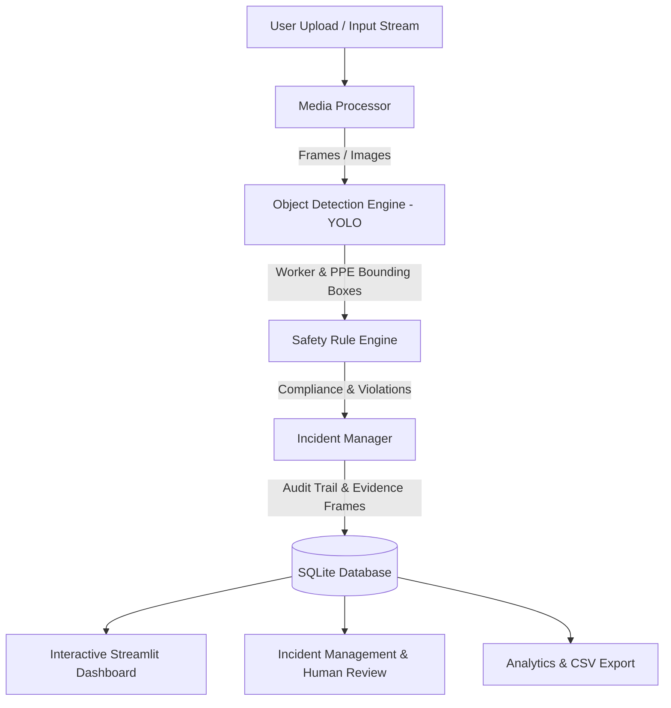

# SafeSight AI System Architecture

## Overview
SafeSight AI provides a modular deep-learning pipeline for industrial personal protective equipment (PPE) compliance monitoring and incident audit management.

## Core Modules
1. **Media Processor (`src/video/video_processor.py` & `src/utils/file_validation.py`)**: Incrementally decodes video frames to prevent memory bloat, preserving exact timestamps.
2. **Detection Engine (`src/models/detector.py`)**: Wraps lightweight YOLO models with dataset-agnostic class normalization.
3. **Safety Rule Engine (`src/safety/ppe_rules.py` & `src/safety/zone_rules.py`)**: Spatial association associating detected helmets and vests with detected workers.
4. **Incident Database (`src/incidents/database.py`)**: SQLite storage recording incidents, review states (`pending`, `confirmed`, `dismissed`, `uncertain`), reviewer notes, and evidence snapshots.
5. **Dashboard & UI (`app.py`, `pages/`)**: Multi-page Streamlit application for end-to-end audit, review, and analytics.
